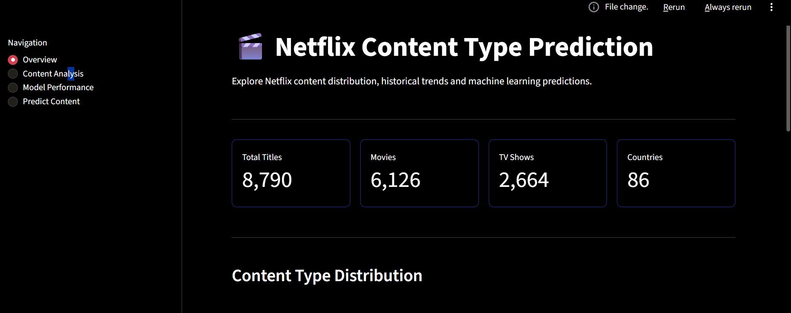
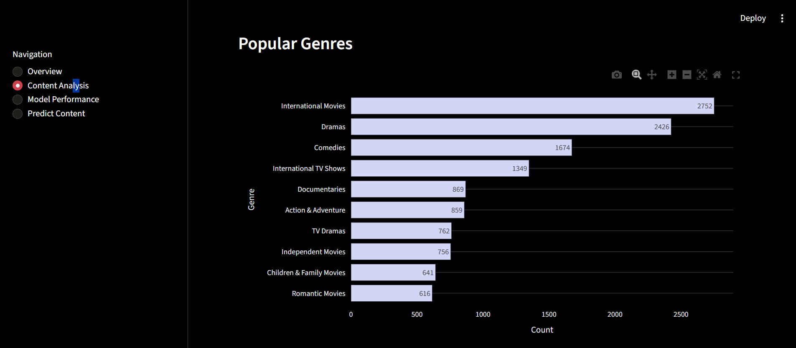
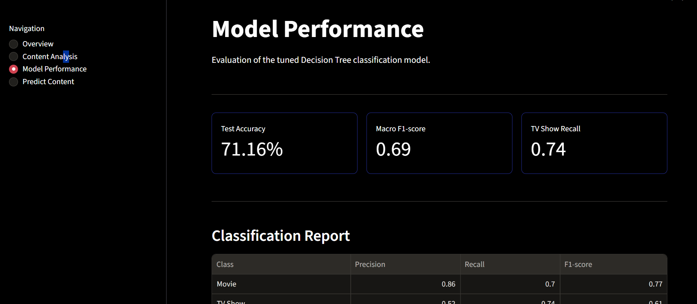
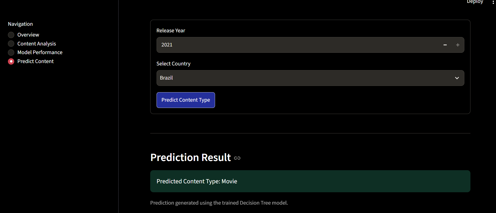

# Netflix Content Type Prediction

A machine learning classification project that predicts whether a Netflix title is a Movie or TV Show based on its release year and country.

The project includes data analysis, feature selection, model comparison, hyperparameter tuning and an interactive dashboard built using Streamlit.

## Project Overview

This project uses a Netflix titles dataset to understand the distribution of Movies and TV Shows and identify patterns in the available content.

I experimented with different classification algorithms to predict the content type. I also explored class imbalance and used hyperparameter tuning to improve the model's ability to identify TV Shows.

The Streamlit dashboard allows users to explore Netflix content trends, view model performance and predict the content type using the release year and country.

## Features

- Analysis of Netflix content distribution.
- Exploring release year, country, rating and genre distributions.
- Identifying class imbalance in the dataset.
- Feature selection and checking for data leakage.
- Encoding categorical features using OneHotEncoder.
- Classification using Logistic Regression, Decision Tree and Random Forest.
- Handling class imbalance using balanced class weights.
- Hyperparameter tuning using GridSearchCV.
- Comparing models using accuracy, precision, recall and F1-score.
- Predicting whether a title is a Movie or TV Show.
- Interactive Streamlit dashboard with visualizations.

## Technologies Used

- Python
- Pandas
- NumPy
- Matplotlib
- Seaborn
- Plotly
- Scikit-learn
- Joblib
- Streamlit
- Jupyter Notebook

## Project Workflow

1. **Data Exploration:** Loaded the Netflix dataset and explored its structure, columns, missing values and duplicate records.

2. **Exploratory Data Analysis:** Studied content distribution, release years, ratings, countries and genres using visualizations.

3. **Feature Selection:** Selected release year and country as the main input features. Excluded rating and genre because they showed strong associations with the target and could introduce data leakage.

4. **Data Preprocessing:** Encoded the country feature using OneHotEncoder and prepared the data for model training.

5. **Model Building:** Trained Logistic Regression, Decision Tree and Random Forest classifiers and compared their performance.

6. **Handling Class Imbalance:** Applied balanced class weights to improve the identification of the minority class (TV Shows).

7. **Hyperparameter Tuning:** Used GridSearchCV with macro F1-score to find suitable Decision Tree parameters.

8. **Model Evaluation:** Compared the models using accuracy, precision, recall, F1-score and confusion matrices.

9. **Model Saving:** Saved the final preprocessing and classification pipeline using Joblib.

10. **Dashboard Development:** Built an interactive Streamlit application for content analysis, model evaluation and predictions.

## Model Evaluation

I trained and compared three classification algorithms using the same training and testing split.

| Model               | Accuracy | TV Show Recall |
| ------------------- | -------: | -------------: |
| Logistic Regression |   76.28% |           0.30 |
| Decision Tree       |   76.45% |           0.34 |
| Random Forest       |   75.82% |           0.27 |
| Tuned Decision Tree |   71.16% |           0.74 |

The original Decision Tree achieved the highest accuracy. However, the dataset was imbalanced, with Movies accounting for approximately 70% of the records.

To improve the identification of TV Shows, I applied class balancing and used GridSearchCV with macro F1-score as the evaluation metric.

The tuned Decision Tree achieved a TV Show recall of 0.74, compared with 0.34 for the original Decision Tree. Although its overall accuracy decreased, it provided more balanced classification performance.

### Final Model

The tuned Decision Tree was selected as the final model.

**Best Parameters:**

- `class_weight`: balanced
- `max_depth`: 10
- `min_samples_leaf`: 2
- `min_samples_split`: 10

**Final Test Results:**

| Metric          |  Score |
| --------------- | -----: |
| Accuracy        | 71.16% |
| Macro Precision |   0.69 |
| Macro Recall    |   0.72 |
| Macro F1-score  |   0.69 |
| TV Show Recall  |   0.74 |

## Dashboard Screenshots

### 1. Overview



### 2. Content Analysis



### 3. Model Performance



### 4. Content Prediction



## Project Structure

```text
Netflix-Content-Type-Prediction/
│
├── app.py
├── dataset.csv
├── content.ipynb
├── requirements.txt
├── README.md
├── .gitignore
│
├── models/
│   └── netflix_content_type_model.pkl
│
└── screenshots/
    ├── overview_page.png
    ├── content_analysis_page.png
    ├── model_performance_page.png
    └── prediction_page.png
```

## How to Run the Project

**1. Clone the repository**

```bash
git clone https://github.com/YOUR-USERNAME/Netflix-Content-Type-Prediction.git
```

**2. Open the project folder**

```bash
cd Netflix-Content-Type-Prediction
```

**3. Install the required libraries**

```bash
pip install -r requirements.txt
```

**4. Run the Streamlit application**

```bash
streamlit run app.py
```

The application will open in your browser.

## Dataset

The project uses a Netflix titles dataset containing 8,790 records and 10 columns.

Some of the important attributes include:

- `type`: Movie or TV Show
- `title`: Name of the content
- `country`: Country associated with the content
- `release_year`: Year of release
- `rating`: Content rating
- `duration`: Duration of the content
- `listed_in`: Genres associated with the content

The target variable is `type`.

For the final model, release year and country were used as input features. Duration was excluded because it directly reveals whether a title is a Movie or TV Show.

## Limitations

- The dataset contains historical Netflix content information and does not represent the current Netflix catalogue.
- The model uses only release year and country for prediction.
- The dataset has an imbalance between Movies and TV Shows.
- Classification performance may vary for unseen data.
- Predictions are based on patterns learned from the available dataset and should not be treated as actual Netflix content classifications.

## Conclusion

Through this project, I learned how to perform exploratory data analysis, select features, build classification models and evaluate their performance.

I also learned how class imbalance can affect model accuracy and how techniques such as balanced class weights and GridSearchCV can improve classification performance.
